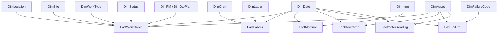

# Synthetic Maximo Dataset for Power BI

A free, openly shareable IBM Maximo-shaped dataset for building and demonstrating
maintenance analytics. **Every row is fabricated.** No client, employer, or
real-world data of any kind is present. Company names, people, assets, and
vendors are invented.

Generated `2026-07-29` · seed `20260729` · 23 tables · ~47 MB CSV · 40,935 work
orders across 3 sites over 3 years (2023-07-01 → 2026-07-29).

---

## Why this exists

There is no free, open sample Maximo dataset. Every Maximo-specific Power BI
asset is behind a vendor paywall or a paid course, while practitioners regularly
ask for a starting point and get none. This fills that gap.

It is deliberately **OLTP-shaped**, the way Maximo actually is — so the
denormalisation into a star schema is a real exercise, not a pre-chewed one.

---

## What makes it non-trivial (on purpose)

| Property | Why it matters |
|---|---|
| Multi-site / multi-org keys | `SITEID` + `ORGID` on nearly every table, as in real Maximo |
| Status history in a separate table | `WOSTATUS` — cycle time requires joining it, not reading `WORKORDER` |
| Nulls exactly where Maximo has them | No `ACTFINISH` on open work; no `PROBLEMCODE` on PM work; blank `ASSETNUM` on location-only work |
| Self-referencing hierarchies | `ASSET.PARENT` and `LOCATIONS.PARENT` |
| Costs that reconcile | `WORKORDER.ACTLABCOST` sums exactly to `LABTRANS`; `ACTMATCOST` to `MATUSETRANS` |
| Role-playing dates | `REPORTDATE`, `TARGCOMPDATE`, `SCHEDSTART`, `ACTFINISH` all want the same date dimension |
| Downtime ≠ labour hours | `DOWNTIMEREPORT.DOWNTIME` is elapsed wall-clock time; `ACTLABHRS` is summed crew hours |

### The data has deliberate signal

Uniformly random data makes a dashboard that says nothing. Each site has a
distinct maintenance personality, so KPI visuals reveal an actual story:

- **BEDFORD** (assembly plant) — mature program. Low reactive work, high PM
  compliance, fast recovery. This is what "good" looks like.
- **HOUSTON** (process facility) — under strain. Reactive work at 45%, PM
  compliance at 70%, backlog nearly double, MTTR 71% worse than Bedford.
- **AURORA** (distribution centre) — improving. Starts near Houston's numbers
  and trends toward Bedford's across the window.

About 5% of assets are "bad actors" with elevated failure rates, so a
top-10-worst-assets visual returns something meaningful. Condition meters on bad
actors drift upward over time, giving a predictive-maintenance signal to find.

---

## Loading into Power BI

1. Open Power BI Desktop → **Get Data → Text/CSV**, or better, **Folder** and
   point at `data/` to load all 23 at once.
2. Recommended: save as a **PBIP** project (File → Options → Preview features →
   Power BI Project save) so the model is Git-diffable TMDL text.
3. Set `DIM_DATE[DATE]` as the date table (Table tools → Mark as date table).
4. Turn **off** Auto Date/Time (Options → Data Load) — it silently adds a hidden
   date hierarchy per date column and bloats the model.

All dates are `YYYY-MM-DD HH:MM:SS` strings; set the locale to English (United
States) or explicitly type those columns as `datetime` in Power Query.

---

## Recommended star schema



| Star object | Built from |
|---|---|
| `FactWorkOrder` | `WORKORDER` (filter out `STATUS = "CAN"` or flag it) |
| `FactLabour` | `LABTRANS` |
| `FactMaterial` | `MATUSETRANS` |
| `FactDowntime` | `DOWNTIMEREPORT` |
| `FactFailure` | `FAILUREREPORT` |
| `FactMeterReading` | `METERREADING` |
| `FactWOStatus` | `WOSTATUS` (optional; for status-duration analysis) |
| `DimAsset` | `ASSET`, optionally widened with `ASSETMETER` |
| `DimLocation` | `LOCATIONS` where `TYPE = "OPERATING"` |
| `DimSite` | `SITE` + `ORGANIZATION` |
| `DimLabor` | `LABOR` + `PERSON` |
| `DimCraft` | `CRAFT` |
| `DimItem` | `ITEM` |
| `DimFailureCode` | `FAILURECODE` |
| `DimPM` / `DimJobPlan` | `PM` / `JOBPLAN` |
| `DimWorkType`, `DimStatus` | Derived from distinct `WORKORDER` values — build these as real tables, don't slice on the fact |
| `DimDate` | `DIM_DATE` |

### Five modelling gotchas worth designing around

1. **Role-playing dates.** `WORKORDER` has six date columns that all want
   `DimDate`. Pick one active relationship (`REPORTDATE` is the usual choice),
   make the rest inactive, and reach them with `USERELATIONSHIP` — or duplicate
   the date dimension per role. Decide deliberately; this is the single most
   common modelling mistake on Maximo data.

2. **Blank `ASSETNUM`.** Location-only work orders carry no asset. A plain
   relationship silently drops them from asset-sliced visuals. Either add an
   "unassigned" member to `DimAsset` or make the exclusion explicit.

3. **Cancelled work orders.** `STATUS = "CAN"` rows have no actuals. Exclude
   them from counts, compliance, and cost, or every KPI is quietly diluted.

4. **Composite keys in real Maximo.** In *this* dataset `ASSETNUM`, `LOCATION`,
   and `WONUM` happen to be globally unique for convenience. In a real Maximo
   database they are only unique **with `SITEID`**. If you swap real data in
   behind this model, build composite keys first or you will silently fan out
   joins across sites.

5. **`DOWNTIME` vs `ACTLABHRS`.** Three technicians working four hours is 12
   labour hours but 4 hours of elapsed downtime. Using `ACTLABHRS` for MTTR
   inflates it by roughly the crew size.

---

## KPI definitions

Formulas follow the standard maintenance-metric definitions maintained by SMRP
(Society for Maintenance & Reliability Professionals), which harmonises with
EN 15341 and complements ISO 55000. SMRP's full guide is members-only — where a
definition below simplifies, that is called out.

| KPI | Definition on this dataset |
|---|---|
| **Reactive Maintenance %** | `(CM + EM work orders) / all non-cancelled work orders` |
| **PM Compliance %** | `PM work orders with ACTFINISH <= TARGCOMPDATE / completed PM work orders` |
| **Schedule Compliance %** | `work orders with ACTSTART within N days of SCHEDSTART / scheduled work orders` |
| **MTTR** | `SUM(DOWNTIMEREPORT[DOWNTIME]) / COUNTROWS(DOWNTIMEREPORT)` |
| **MTBF** | `operating hours / failure events`. Requires an operating-hours assumption — see caveat below |
| **Backlog (weeks)** | `SUM(open ESTLABHRS) / weekly craft capacity`. Capacity is not in the data; derive it from `LABOR` headcount × 40, or set it as a parameter |
| **Total Maintenance Cost** | `ACTLABCOST + ACTMATCOST + ACTTOOLCOST + ACTSERVCOST` |
| **Bad Actors** | `COUNTROWS(FAILUREREPORT)` by `ASSETNUM`, descending |

**MTBF caveat.** True MTBF needs asset operating hours, which Maximo only knows
if a `RUNHOURS` meter is maintained. Here, 45% of assets have a meter and only
some of those are `RUNHOURS`. For the remainder you must choose an assumption —
calendar hours, calendar hours minus reported downtime, or a fixed utilisation
factor. State whichever you pick on the report face. Do not present MTBF as
exact when the denominator is assumed.

---

## KPI baselines — use these as DAX test cases

These are computed directly from the CSVs by the generator's validation pass.
If your DAX disagrees with these numbers, your DAX is wrong. Cancelled work
orders are excluded throughout.

| Metric | BEDFORD | HOUSTON | AURORA | All sites |
|---|--:|--:|--:|--:|
| Work orders (excl. cancelled) | 10,462 | 19,474 | 10,999 | 40,935 |
| Reactive % | 21.0% | 44.8% | 30.9% | 35.0% |
| PM work orders | 6,845 | 8,070 | 6,099 | 21,014 |
| PM compliance % | 93.2% | 69.3% | 85.2% | 81.8% |
| Open work orders | 578 | 1,418 | 600 | 2,596 |
| Open estimated labour hours | 2,860.6 | 9,739.1 | 3,203.2 | 15,803.0 |
| Total maintenance cost | $6,020,214 | $15,435,868 | $7,250,332 | $28,706,414 |
| Failure events | 2,127 | 8,246 | 3,289 | 13,662 |
| Downtime events | 1,157 | 4,608 | 1,741 | 7,506 |
| Downtime hours | 10,458.6 | 71,685.4 | 18,842.0 | 100,986.0 |
| MTTR (hours) | 9.04 | 15.56 | 10.82 | 13.45 |

Top bad actors (all sites), by failure count: `VALVE-00387` (107), `ANALYZER-00532` (99), `MOTOR-00349` (81), `MIXER-00392` (81), `BOILER-00409` (80).

Full integrity report and table manifest: `VALIDATION.txt`.

---

## Derived artifacts in this package

| File | What it is |
|---|---|
| `power-query-transforms.m` | Every Power Query query, raw CSV → star schema. Paste one block per query into Advanced Editor. |
| `dax-measures.dax` | The six core KPI measures plus MTBF/availability and supporting measures, each with its expected value inline. |
| `verify_measures.py` | Rebuilds the star schema in pandas and re-derives all eight measures from the CSVs. Confirms the definitions reproduce the baselines. Run it after changing anything. |

`verify_measures.py` parses its expected values out of `VALIDATION.txt` rather
than hardcoding them, so it cannot silently drift out of step with the generator.

### Cost realism

The cost mix is deliberately calibrated, because an implausible one is the
fastest way to lose a reliability audience:

| | Labour | Materials | Tools/rental | Contracted services |
|---|--:|--:|--:|--:|
| Share of total spend | 47.7% | 39.8% | 2.5% | 10.1% |

`REPLACECOST` is **installed** replacement value (2.2–3.0× purchase price), which
is the correct basis for SMRP's maintenance-cost-as-%-of-RAV metric — not the
equipment invoice. Total RAV is $155.8M. Annual maintenance runs at 6.0% of RAV
overall (Bedford 4.0%, Houston 7.1%, Aurora 6.6%) against an SMRP best-in-class
benchmark of 2–3%. That is intentional: this is a portfolio with one healthy site
and one in trouble, not a best-in-class showcase.

### The date-truncation trap

Worth knowing before you write a single compliance measure. `ACTFINISH`
2026-06-30 14:00 is **not** `<=` `TARGCOMPDATE` 2026-06-30 12:00 at datetime
precision — but the work *was* completed on the target day. Comparing raw
datetimes instead of date-only columns understates PM compliance on this dataset
by **22.1 percentage points** (81.8% → 59.7%, 4,290 work orders misclassified).
The Power Query transforms materialise date-only columns specifically to prevent
this.

---

## Regenerating or reshaping the data

```bash
python3 generate_maximo_dataset.py
```

No third-party dependencies — standard library only. Everything configurable
sits in the `CONFIG` block at the top of the script: seed, date window, site
count and personalities, asset counts, asset classes, failure taxonomy, craft
rates, and part catalogue.

Reproducibility is exact. The same seed and config produce **byte-identical**
CSVs (verified with `cmp` across runs). Change `SEED` for a different but
equally valid dataset. Note that editing the script changes how the random
stream is consumed, so the numbers in this README belong to this exact version.

### Integrity checks the generator enforces

All twelve pass on the shipped data:

- Referential integrity from `LABTRANS`, `MATUSETRANS`, `WOSTATUS`,
  `FAILUREREPORT`, `DOWNTIMEREPORT` back to `WORKORDER` / `ASSET`
- `REPORTDATE <= ACTSTART <= ACTFINISH` on every work order
- No open work order carries an `ACTFINISH`
- No PM work order carries a `PROBLEMCODE`
- `WORKORDER.ACTLABCOST` reconciles to `LABTRANS` to the cent
- `WORKORDER.ACTMATCOST` reconciles to `MATUSETRANS` to the cent

---

## What is simplified relative to real Maximo

Named honestly, because these are the things someone will ask about:

- **No purchasing chain.** `PR`, `PO`, `POLINE`, `INVOICE` are absent. Material
  cost enters through `MATUSETRANS` only.
- **No service requests or tickets.** `SR`, `INCIDENT`, `PROBLEM` are absent;
  all work originates as a work order.
- **Flattened craft rates.** Real Maximo holds rates in `CRAFTRATE` /
  `LABORCRAFTRATE` with effective dates. Here a single rate sits on `CRAFT` and
  `LABOR`.
- **No task-level work orders.** `ISTASK` is always 0; there are no child task
  rows or `WOACTIVITY`. `JOBTASK` exists on the job plan side only.
- **`INVENTORY` is a snapshot,** not balance history — no `INVBALANCES` or
  `INVTRANS`.
- **No `LOCHIERARCHY` / `LOCANCESTOR`.** Location hierarchy is the `PARENT`
  self-reference only, so multi-network hierarchies are not represented.
- **No attachments, work logs, safety plans, or classifications** beyond a
  `CLASSSTRUCTUREID` stub.
- **`CRITICALITY` is not an out-of-the-box Maximo column.** It is one of the
  most common customisations, so it is included — but flag it as a custom field
  if you demo against a stock schema.

None of these prevent any of the eight KPIs above from being built.

---

## Licence and attribution

The generator script and this documentation are offered for free reuse. The data
is synthetic and carries no third-party rights. "Maximo" and "IBM Maximo" are
trademarks of IBM; this project is unaffiliated with and not endorsed by IBM.
