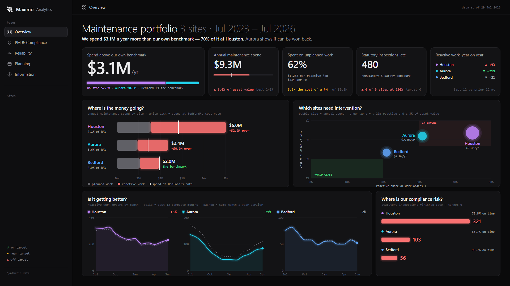
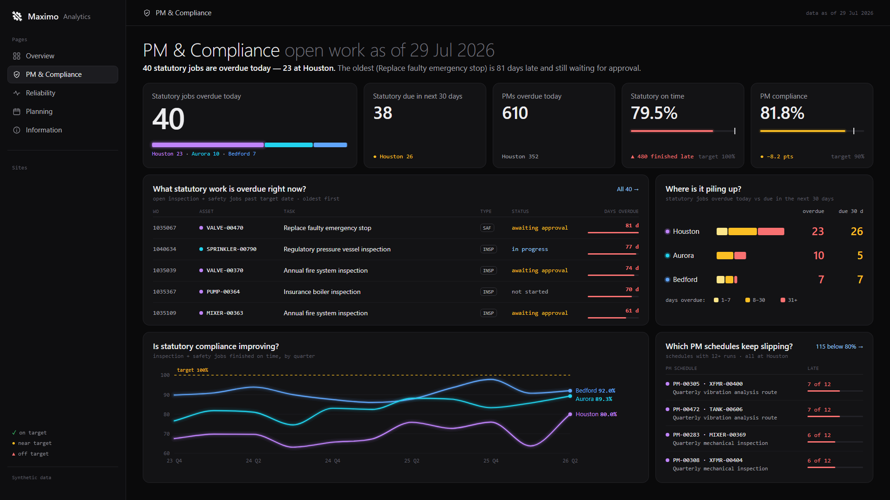
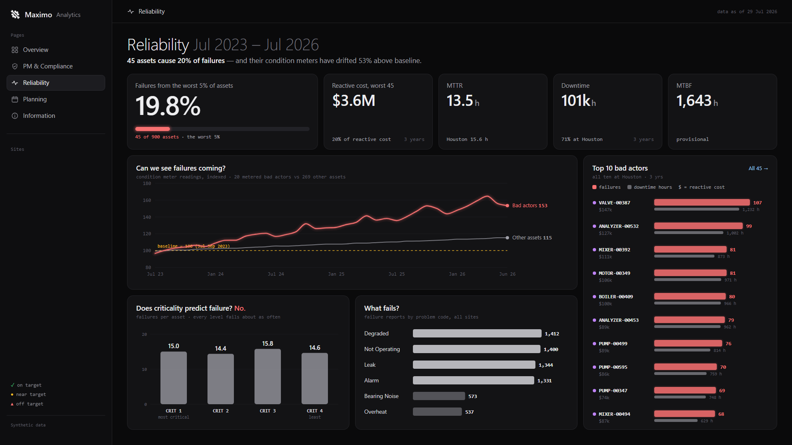
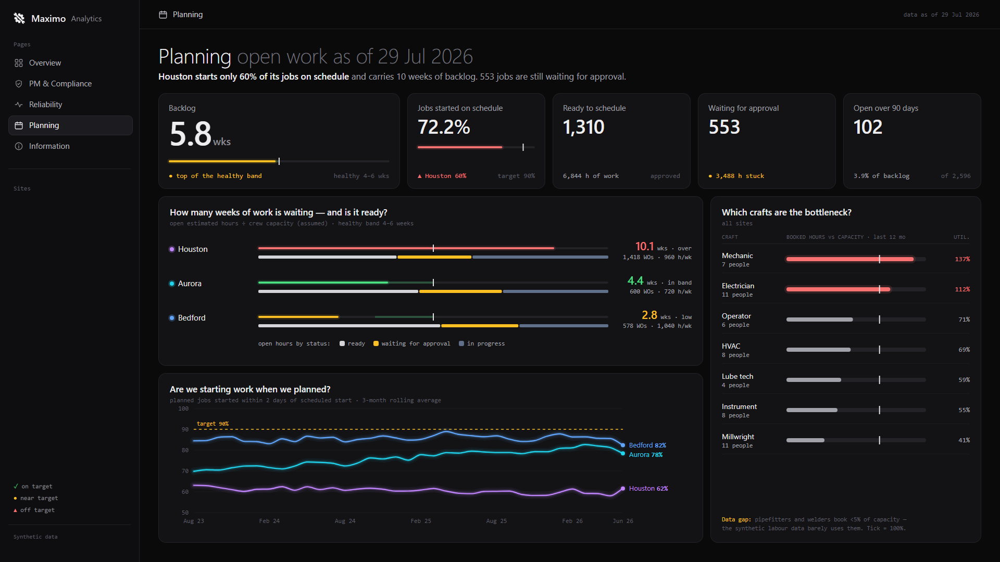
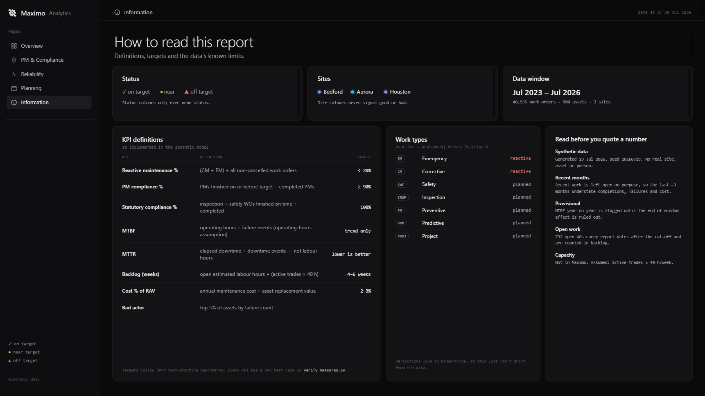
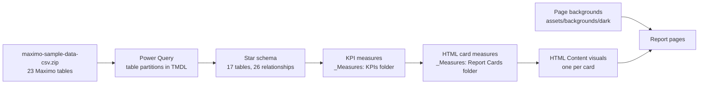
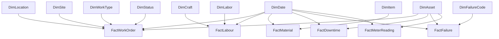

# Maximo Maintenance Analytics — Power BI

A five-page Power BI report on maintenance performance across three plants, built on a
free, fully **synthetic** IBM Maximo–shaped dataset. Every number in it traces back to
the CSVs in this repo, and every KPI has a test case.



**Power BI project (PBIP)** · **5 report pages** · **17-table star schema** · **102 DAX measures**
· **40,935 work orders, 3 sites, Jul 2023 – Jul 2026** · **no real data of any kind**

---

## Contents

- [What the report answers](#what-the-report-answers)
- [The pages](#the-pages)
  - [Overview](#1-overview--for-the-vp) · [PM & Compliance](#2-pm--compliance--for-the-compliance-lead)
    · [Reliability](#3-reliability--for-the-reliability-engineer) · [Planning](#4-planning--for-the-planner)
    · [Information](#5-information--how-to-read-the-report)
- [Reading the report](#reading-the-report)
- [Open it yourself](#open-it-yourself)
- [How it is built](#how-it-is-built)
- [Changing the report](#changing-the-report)
- [How the numbers are checked](#how-the-numbers-are-checked)
- [KPI definitions and baselines](#kpi-definitions-and-baselines)
- [Known limits](#known-limits)
- [The dataset](#the-dataset)
- [Repository map](#repository-map)
- [Licence and attribution](#licence-and-attribution)

---

## What the report answers

Each page is written for one person and opens with a single-sentence headline that the
data rewrites as it changes. The cards underneath are each a question, answered by
one chart.

| Page | Audience | The question it answers |
|---|---|---|
| **Overview** | VP / portfolio owner | Where are we overspending, which site needs intervention, and is it getting better? |
| **PM & Compliance** | Compliance lead | What statutory work is overdue right now, what falls due next, and which PM schedules keep slipping? |
| **Reliability** | Reliability engineer | Which assets cause our failures, can we see failures coming, and does criticality predict anything? |
| **Planning** | Planner / scheduler | How much work is waiting, is it ready, are we starting on time, and which crafts are the bottleneck? |
| **Information** | Everyone | What each KPI means, what the colours mean, and the data's known limits. |

The three sites have deliberately different personalities, so the report tells a story:
**Bedford** is a mature program and is used as the internal cost benchmark,
**Houston** is under strain, and **Aurora** is improving.

---

## The pages

All five screenshots below are rendered from the report's own measures over the page
backgrounds. The site list and year buttons are standard Power BI slicers, so they are
not shown.

### 1. Overview — for the VP

> *We spend $3.1M a year more than our own benchmark — 70% of it at Houston. Aurora shows it can be won back.*


| Card | What it shows | How to read it |
|---|---|---|
| **Spend above our own benchmark** | Annual spend above what each site would spend at Bedford's cost rate (cost as % of asset value), split by site | The money on the table. Bedford is the benchmark, so it is always $0. |
| **Annual maintenance spend** | Total annual spend, with cost as % of replacement asset value on a 0–10% bar | The green band is SMRP best practice (2–3%); the tick is 3%. |
| **Spent on unplanned work** | Reactive share of spend, and the cost of a reactive job against a PM | A reactive job costs about 5.5× a PM. |
| **Statutory inspections late** | Inspection + safety jobs finished after their target date | Target is 0; the footer counts sites at 100% on time. |
| **Reactive work, year on year** | Reactive work orders, last 12 complete months vs the 12 before | Green = down more than 5%, red = up, grey = flat. |
| **Where is the money going?** | One bar per site: planned (grey) + reactive (red); the white tick is spend at Bedford's rate | Everything right of the tick is the overspend. |
| **Which sites need intervention?** | Reactive share of work orders against cost % of asset value; bubble size = spend | Bottom-left green zone is world class; top-right red zone needs action. |
| **Is it getting better?** | Monthly reactive work orders per site, last 12 months (solid, shaded) vs a year earlier (dashed) | Each panel has its own scale. Fixed to the data cut-off. |
| **Where is our compliance risk?** | Statutory jobs finished late, per site, with % on time | Worst site first. |

### 2. PM & Compliance — for the compliance lead

> *40 statutory jobs are overdue today — 23 at Houston. The oldest (Replace faulty emergency stop) is 81 days late and still waiting for approval.*



| Card | What it shows | How to read it |
|---|---|---|
| **Statutory jobs overdue today** | Open inspection + safety jobs past their target date, by site | Today = the data cut-off, 29 Jul 2026. |
| **Statutory due in next 30 days** | Open statutory jobs falling due in the next 30 days | Footer names the site with the most. |
| **PMs overdue today** | Open PMs past their target date | |
| **Statutory on time** | Completed statutory jobs finished on or before target; target 100% | |
| **PM compliance** | Completed PMs finished on or before target; target 90% | Footer is the gap to target in points. |
| **What statutory work is overdue right now?** | The five oldest overdue statutory jobs: asset, task, type, status, days late | Status is in plain words: awaiting approval / not started / in progress. |
| **Where is it piling up?** | Overdue jobs per site by days late (1–7, 8–30, 31+) against what falls due in 30 days | A long red end means old, stuck work. |
| **Is statutory compliance improving?** | On-time % by due quarter, one line per site, target 100% dashed | Follows the year buttons. |
| **Which PM schedules keep slipping?** | The four PM schedules (12+ finished runs) with the lowest on-time rate | The link counts all schedules below 80%. |

### 3. Reliability — for the reliability engineer

> *45 assets cause 20% of failures — and their condition meters have drifted 53% above baseline.*



| Card | What it shows | How to read it |
|---|---|---|
| **Failures from the worst 5% of assets** | Share of all failure reports that come from the worst 5% of assets ("bad actors") | 45 of 900 assets cause about 1 in 5 failures. |
| **Reactive cost, worst 45** | Reactive work-order cost of the 45 costliest assets | |
| **MTTR** | Elapsed downtime per downtime event (not labour hours) | Footer names the slowest site. |
| **Downtime** | Total downtime hours | |
| **MTBF** | Operating hours per failure | Marked provisional: it rests on an operating-hours assumption. |
| **Can we see failures coming?** | Condition-meter readings indexed to each meter's first three months (= 100): bad actors (red) vs every other metered asset (grey) | Bad actors drift away from baseline months ahead: a predictive signal. Full data window. |
| **Does criticality predict failure?** | Failures per asset at each criticality level | Answers itself: "No." when the levels are within 25% of each other. |
| **What fails?** | Failure reports by problem code, top six | |
| **Top 10 bad actors** | Failures (red), downtime hours (grey) and reactive cost per asset | |

### 4. Planning — for the planner

> *Houston starts only 60% of its jobs on schedule and carries 10 weeks of backlog. 553 jobs are still waiting for approval.*



| Card | What it shows | How to read it |
|---|---|---|
| **Backlog** | Open estimated labour hours ÷ weekly crew capacity, in weeks | Healthy band 4–6 weeks. |
| **Jobs started on schedule** | Jobs started within 2 days of their scheduled start, last 12 months; target 90% | Footer names the worst site. |
| **Ready to schedule** | Open jobs approved (APPR), with their estimated hours | |
| **Waiting for approval** | Open jobs not yet approved (WAPPR), with their hours | Work that cannot be scheduled yet. |
| **Open over 90 days** | Open jobs older than 90 days, as a share of the backlog | |
| **How many weeks of work is waiting — and is it ready?** | Per site: backlog weeks on a 0–12 scale (band 4–6), and open hours split ready / waiting for approval / in progress | Houston is over the band, Bedford under it. |
| **Are we starting work when we planned?** | On-schedule %, 3-month rolling average by month, one line per site, target 90% | Full data window. |
| **Which crafts are the bottleneck?** | Booked hours over the last 12 months against capacity (people × 40 h × 52 weeks) | Over 100% (tick) means overtime or contractors. |

### 5. Information — how to read the report



Status and site colour keys, the data window, every KPI definition with its target, the
work types (read live from `DimWorkType`, so the list cannot drift from the data), and
the caveats to read before quoting a number.

---

## Reading the report

**Colour means one thing each.**

| Colour | Meaning |
|---|---|
| ✓ green / ● amber / ▲ red | Status only: on target / near target / off target |
| purple / cyan / blue | Site only: Houston / Aurora / Bedford. Never good or bad. |
| white tick on a bar | The target or benchmark |

**Filters.**

- **Site list:** filters every card on Overview, PM & Compliance, Reliability and Planning.
- **Year buttons:** filter the spend, cost, compliance and reliability cards. They appear
  only on Overview, PM & Compliance and Reliability: Planning is entirely "as of today"
  or fixed rolling windows, so a year has nothing to filter there.
- **Information** is reference text and has no slicers.
- **Cards that always show "now" or a fixed window** state it in their subtitle:
  - "today" counts (overdue, due next 30 days, backlog);
  - year-on-year;
  - the meter-drift and schedule trends.

**"Today" is the data cut-off, 29 Jul 2026,** shown top right on every page. All date
comparisons are date-only (see [the date-truncation trap](#the-date-truncation-trap)).

---

## Open it yourself

**You need:** Power BI Desktop (built and tested on 2.159, November 2026) with PBIP
support, and internet access the first time you open it. The report uses the free
**HTML Content** custom visual from AppSource, which Desktop downloads automatically.

1. **Get the data.** Unzip `maximo-sample-data-csv.zip` into a `data/` folder at the
   repo root. The folder is git-ignored; the zip is the tracked copy.
2. **Open** `MaximoPowerBI.pbip` in Power BI Desktop.
3. **Point it at the data.** Transform data → Edit parameters → set `pSourceFolder` to
   your `data` folder (the default is `C:\dev\MaximoPowerBi\data`). Then **Refresh**.

> If your organisation blocks custom visuals, the cards render empty. The model and
> measures still work; only the drawing needs the HTML Content visual.

---

## How it is built



**Semantic model.** Power Query turns the raw OLTP-shaped extracts into a 17-table star
schema: six fact tables and eleven dimensions. Every date in it is date-only, and `DimDate` is
the single marked date table, with `ReportDate` active and `TargCompDate` /
`ActFinishDate` reached through `USERELATIONSHIP`. Model and report are saved as PBIP
text (TMDL + PBIR JSON), so every change is diffable.

**Measures in two layers,** all in the `_Measures` table
(`MaximoPowerBI.SemanticModel/definition/tables/_Measures.tmdl`), grouped by display folder:

1. **KPIs** (`KPIs\…` folders: Work Orders, PM & Compliance, Reliability,
   Backlog & Planning, Cost, Date Window):
   - reactive %, PM compliance, schedule compliance, MTTR, MTBF, backlog, cost % of RAV,
     each checked against `VALIDATION.txt`;
   - the benchmark logic (spend above Bedford's cost rate);
   - statutory compliance (`WORKTYPE` INSP + SAF);
   - overdue buckets;
   - year-on-year windows fixed to the cut-off.
2. **Card measures** (`Report Cards\…` folders, one per page): one measure per card,
   returning an SVG drawing of that card built from the KPI measures.

**Why the cards are SVG.** Native visuals cannot draw the design: rounded bars, glow,
shaded areas under smooth lines, inline labels. Each card measure returns one
`<svg>` whose `viewBox` is the card's size in page pixels, with `width="100%"`, so it
scales with the page like a native visual. Glow is drawn as wider, fainter copies of a
line, with no SVG filters. Lines use a monotone cubic curve, so they never overshoot
a data point. Because the drawing is a measure, every card still follows the slicers.

**Page backgrounds.** The card frames, sidebar and logo are a background image per
page (`assets/backgrounds/dark/*.png`, with editable `.svg` masters that import into
Figma as named layers). Their geometry is measured from the HTML mockups in
`assets/mockups/`, so frames, mockups and visuals line up exactly.

---

## Changing the report

All scripts run from the repo root. **Close Power BI Desktop before running any of
them**, because Desktop overwrites PBIP files it has open.

| To change… | Edit | Then run |
|---|---|---|
| A number or a card's drawing | the measure in Power BI Desktop, or in `_Measures.tmdl` with Desktop closed | `py -3 check_model.py MaximoPowerBI.SemanticModel` |
| A Power Query step | the table's query in Desktop, or its `partition` block in `tables/<Table>.tmdl` | Refresh in Desktop, then `py -3 verify_measures.py` |
| Which card sits where, slicers, page buttons | `scripts/build_report_pages.py` (the `PAGES` table) | `py -3 scripts/build_report_pages.py` |
| A page background | `assets/backgrounds/dark/<page>.svg` (e.g. in Figma), export the PNG at 3840 × 2160 | `py -3 scripts/build_report_pages.py` |
| Backgrounds from the mockups | `assets/mockups/*.html` | `py -3 assets/backgrounds/build_dark_backgrounds.py` |
| The mockups themselves | `scripts/mockups/gen_*.py` | `py -3 scripts/mockups/render.py` |

The TMDL files are the single source: every measure and query lives once, in the model.
To paste in several measures drafted in a `.dax` file, `scripts/add_measures.py <file>.dax`
copies each block into `_Measures.tmdl`, replacing a measure in place if it exists. Comment
lines become the measure's description, and `// @format` lines become its format string.
`build_report_pages.py` rewrites the five page folders from scratch and registers the
theme and backgrounds; it never touches other pages.

---

## How the numbers are checked

| Check | Command | Last result |
|---|---|---|
| Model structure: tables, relationships, column types, date table, core measures | `py -3 check_model.py MaximoPowerBI.SemanticModel` | 0 FAIL, 0 WARN |
| KPI definitions re-derived in pandas from the CSVs and compared with `VALIDATION.txt` | `py -3 verify_measures.py` | all six reproduce the baselines exactly |

The redesign was also checked in Power BI's own engine. Every figure on every page was
recomputed independently from the CSVs and compared:

- with all sites selected;
- with Houston only and with Bedford only;
- with 2025 only.

---

## KPI definitions and baselines

Formulas follow the maintenance-metric definitions maintained by SMRP (Society for
Maintenance & Reliability Professionals), which harmonise with EN 15341.

| KPI | Definition in this model | Target |
|---|---|---|
| **Reactive maintenance %** | `(CM + EM work orders) / all non-cancelled work orders` | < 20% |
| **PM compliance %** | PMs with `ACTFINISH <= TARGCOMPDATE` (date-only) / completed PMs | ≥ 90% |
| **Statutory compliance %** | Inspection + safety jobs finished on time / completed | 100% |
| **Schedule compliance %** | Jobs started within 2 days of `SCHEDSTART` / scheduled jobs | 90% |
| **MTTR** | `SUM(DOWNTIME) / COUNTROWS(downtime events)`: elapsed, not labour hours | lower is better |
| **MTBF** | (operating assets × calendar hours − downtime) / failure events | trend only |
| **Backlog (weeks)** | Open estimated hours / (active trades × 40 h) | 4–6 weeks |
| **Cost % of RAV** | Annual maintenance cost / replacement asset value | 2–3% |
| **Bad actor** | Top 5% of assets by failure count | — |

**MTBF caveat.** True MTBF needs operating hours, which Maximo only knows from a
`RUNHOURS` meter, and only some assets have one. This model assumes operating
hours = operating assets × calendar hours − reported downtime, and the report labels
MTBF *provisional*.

### Baselines: use these as DAX test cases

Computed directly from the CSVs by the generator's validation pass. If a measure
disagrees, the measure is wrong. Cancelled work orders are excluded throughout.

| Metric | BEDFORD | HOUSTON | AURORA | All sites |
|---|--:|--:|--:|--:|
| Work orders (excl. cancelled) | 10,462 | 19,474 | 10,999 | 40,935 |
| Reactive % | 21.0% | 44.8% | 30.9% | 35.0% |
| PM work orders | 6,845 | 8,070 | 6,099 | 21,014 |
| PM compliance % | 93.2% | 69.3% | 85.2% | 81.8% |
| Open work orders | 578 | 1,418 | 600 | 2,596 |
| Open estimated labour hours | 2,860.6 | 9,739.1 | 3,203.2 | 15,803.0 |
| Total maintenance cost | $6,020,214 | $15,435,868 | $7,250,332 | $28,706,414 |
| Failure events | 2,127 | 8,246 | 3,289 | 13,662 |
| Downtime events | 1,157 | 4,608 | 1,741 | 7,506 |
| Downtime hours | 10,458.6 | 71,685.4 | 18,842.0 | 100,986.0 |
| MTTR (hours) | 9.04 | 15.56 | 10.82 | 13.45 |
| MTBF (hours, provisional) | 4,006 | 908 | 1,956 | 1,643 |
| Annual cost % of RAV | 4.0% | 7.1% | 6.6% | 6.0% |

Top bad actors (all sites), by failure count: `VALVE-00387` (107), `ANALYZER-00532` (99),
`MOTOR-00349` (81), `MIXER-00392` (81), `BOILER-00409` (80). Full integrity report:
`VALIDATION.txt`.

---

## Known limits

- **Slicers are native.** The site list and year buttons are standard Power BI slicers
  and look plainer than the rest of the design.
- **Cards don't cross-filter.** Clicking a card does not filter the rest of the page,
  and cards have no hover tooltips.
- **The "All 40 →" links** on the cards are labels, not drill-throughs.
- **Assumed capacity.** Crew capacity is not in Maximo; it is assumed as active trades
  × 40 h/week. Welders and pipefitters book under 5% of capacity in the synthetic
  labour data, so the craft card leaves them out and says so.
- **Recent months understate.** Recent work is left open on purpose, so the last ~3
  months understate completions, failures and cost.
- **Future report dates.** 732 open work orders carry report dates after the cut-off
  and are counted in the backlog.
- **The mockups differ slightly.** The mockups in `assets/mockups/` were drawn from a
  script that compared date-times. The report compares dates, so a few figures differ
  (for example, oldest overdue job 81 days vs 80 in the mockup). The report is the
  correct one.

---

## The dataset

A free, openly shareable IBM Maximo–shaped dataset for building and demonstrating
maintenance analytics. **Every row is fabricated.** No client, employer, or
real-world data of any kind is present. Company names, people, assets and vendors are
invented.

Generated `2026-07-29` · seed `20260729` · 23 tables · ~47 MB CSV · 40,935 work
orders across 3 sites over 3 years (2023-07-01 → 2026-07-29).

### Why it exists

There is no free, open sample Maximo dataset. Every Maximo-specific Power BI asset is
behind a vendor paywall or a paid course. This fills that gap. It is deliberately
**OLTP-shaped**, the way Maximo actually is, so denormalising it into a star schema
is a real exercise, not a pre-chewed one.

### What makes it non-trivial (on purpose)

| Property | Why it matters |
|---|---|
| Multi-site / multi-org keys | `SITEID` + `ORGID` on nearly every table, as in real Maximo |
| Status history in a separate table | `WOSTATUS`: cycle time requires joining it, not reading `WORKORDER` |
| Nulls exactly where Maximo has them | No `ACTFINISH` on open work; no `PROBLEMCODE` on PM work; blank `ASSETNUM` on location-only work |
| Self-referencing hierarchies | `ASSET.PARENT` and `LOCATIONS.PARENT` |
| Costs that reconcile | `WORKORDER.ACTLABCOST` sums exactly to `LABTRANS`; `ACTMATCOST` to `MATUSETRANS` |
| Role-playing dates | `REPORTDATE`, `TARGCOMPDATE`, `SCHEDSTART`, `ACTFINISH` all want the same date dimension |
| Downtime ≠ labour hours | `DOWNTIMEREPORT.DOWNTIME` is elapsed wall-clock time; `ACTLABHRS` is summed crew hours |

### The data has deliberate signal

Uniformly random data makes a dashboard that says nothing. Each site has a distinct
maintenance personality:

- **BEDFORD** (assembly plant): a mature program. Low reactive work, high PM compliance,
  fast recovery. This is what "good" looks like.
- **HOUSTON** (process facility): under strain. Reactive work at 45%, PM compliance at
  69%, backlog nearly double, MTTR 72% worse than Bedford.
- **AURORA** (distribution centre): improving. It starts near Houston's numbers and
  trends toward Bedford's across the window.

About 5% of assets are bad actors with elevated failure rates, and condition meters on
bad actors drift upward over time, giving a predictive-maintenance signal to find.

### Star schema



| Star object | Built from |
|---|---|
| `FactWorkOrder` | `WORKORDER` (cancelled rows flagged) |
| `FactLabour` | `LABTRANS` |
| `FactMaterial` | `MATUSETRANS` |
| `FactDowntime` | `DOWNTIMEREPORT` |
| `FactFailure` | `FAILUREREPORT` |
| `FactMeterReading` | `METERREADING` |
| `DimAsset` | `ASSET` |
| `DimLocation` | `LOCATIONS` |
| `DimSite` | `SITE` + `ORGANIZATION` |
| `DimLabor` | `LABOR` + `PERSON` |
| `DimCraft`, `DimItem`, `DimFailureCode` | `CRAFT`, `ITEM`, `FAILURECODE` |
| `DimWorkType`, `DimStatus` | Real tables with definitions and sort orders, not sliced on the fact |
| `DimDate` | `DIM_DATE` |

### Five modelling gotchas worth designing around

1. **Role-playing dates.** `WORKORDER` has six date columns that all want `DimDate`.
   Pick one active relationship (`REPORTDATE`), make the rest inactive, and reach them
   with `USERELATIONSHIP`. This is the most common modelling mistake on Maximo data.
2. **Blank `ASSETNUM`.** Location-only work orders carry no asset. A plain relationship
   silently drops them from asset-sliced visuals.
3. **Cancelled work orders.** `STATUS = "CAN"` rows have no actuals. Exclude them from
   counts, compliance and cost, or every KPI is quietly diluted.
4. **Composite keys in real Maximo.** Here `ASSETNUM`, `LOCATION` and `WONUM` are
   globally unique for convenience. In real Maximo they are unique only **with
   `SITEID`**, so build composite keys before swapping real data in.
5. **`DOWNTIME` vs `ACTLABHRS`.** Three technicians working four hours is 12 labour
   hours but 4 hours of downtime. Using `ACTLABHRS` for MTTR inflates it by roughly the
   crew size.

### The date-truncation trap

`ACTFINISH` 2026-06-30 14:00 is **not** `<=` `TARGCOMPDATE` 2026-06-30 12:00 at
datetime precision, but the work *was* completed on the target day. Comparing raw
datetimes understates PM compliance on this dataset by **22.1 percentage points**
(81.8% → 59.7%, 4,290 work orders misclassified). The Power Query transforms
materialise date-only columns to prevent this, and the whole report compares dates only.

### Cost realism

| | Labour | Materials | Tools/rental | Contracted services |
|---|--:|--:|--:|--:|
| Share of total spend | 47.7% | 39.8% | 2.5% | 10.1% |

`REPLACECOST` is **installed** replacement value (2.2–3.0× purchase price), the correct
basis for cost as % of RAV. Total RAV is $155.8M. Annual maintenance runs at 6.0% of RAV
against an SMRP best-in-class 2–3%, which is intentional: one healthy site and one in
trouble.

### Regenerating the data

```bash
python3 generate_maximo_dataset.py
```

Standard library only. Seed, date window, sites and their personalities, asset counts,
failure taxonomy, craft rates and part catalogue all sit in the `CONFIG` block. The same
seed and config produce **byte-identical** CSVs. Editing the script changes the random
stream, so the numbers in this README belong to this exact version.

The generator enforces twelve integrity checks:
- referential integrity from every child table back to `WORKORDER` / `ASSET`;
- `REPORTDATE <= ACTSTART <= ACTFINISH`;
- no `ACTFINISH` on open work;
- no `PROBLEMCODE` on PMs;
- labour and material costs reconcile to the cent.

### What is simplified relative to real Maximo

- **No purchasing chain** (`PR`, `PO`, `INVOICE`). Material cost enters through
  `MATUSETRANS` only.
- **No service requests or incidents.** All work starts as a work order.
- **Flattened craft rates.** A single rate sits on `CRAFT` and `LABOR`, with no
  effective-dated rate tables.
- **No task-level work orders** or `WOACTIVITY`.
- **`INVENTORY` is a snapshot,** not balance history.
- **No `LOCHIERARCHY`.** Location hierarchy is the `PARENT` self-reference only.
- **`CRITICALITY` is a common customisation,** not an out-of-the-box Maximo column.

---

## Repository map

| Path | What it is |
|---|---|
| `MaximoPowerBI.pbip` | Open this in Power BI Desktop |
| `MaximoPowerBI.SemanticModel/` | The model as TMDL text: tables, relationships, all 102 measures |
| `MaximoPowerBI.Report/` | The report as PBIR JSON: pages, visuals, theme, backgrounds |
| `MaximoPowerBI.SemanticModel/definition/tables/` | One file per table: its Power Query and columns; `_Measures.tmdl` holds every measure, with expected values in the descriptions |
| `scripts/add_measures.py` | Copies measures drafted in a `.dax` file into the model |
| `scripts/build_report_pages.py` | Builds the five report pages |
| `scripts/mockups/` | Mockup generators, the figures behind them, and the renderer |
| `assets/mockups/` | Design mockups (HTML + PNG), every version |
| `assets/backgrounds/` | Page-background builders; `dark/` holds the current SVG masters and PNGs |
| `assets/theme/maximo_dark.json` | Power BI report theme |
| `docs/images/` | The page images in this README |
| `check_model.py` | Validates the model's structure |
| `verify_measures.py` | Re-derives the KPIs from the CSVs and checks the baselines |
| `build_relationships.py`, `tidy_model_layout.py` | Generate relationships and the model-diagram layout |
| `generate_maximo_dataset.py` | Builds the synthetic dataset |
| `maximo-sample-data-csv.zip` | The 23 CSVs (unzip to `data/`) |
| `DATA_DICTIONARY.md`, `VALIDATION.txt` | Column-level dictionary and the generator's integrity report |

---

## Licence and attribution

The generator, report and documentation are offered for free reuse. The data is
synthetic and carries no third-party rights. "Maximo" and "IBM Maximo" are trademarks of
IBM; this project is unaffiliated with and not endorsed by IBM. The HTML Content visual
is a third-party AppSource visual under its own licence.
